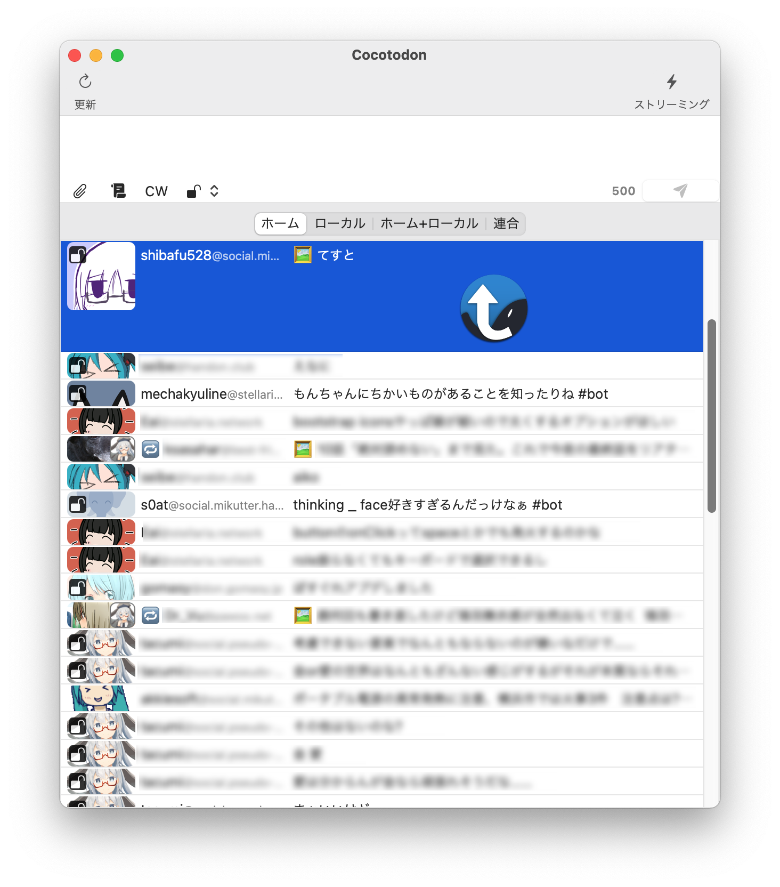

Cocotodon
===

どこか懐かしい感じのMastodonクライアント

<div align="center">

</div>

## Features

* P3:PeraPeraPrvやYoruFukurouのような1行表示
* 投稿ができる
* 画像投稿ができる
* ふぁぼとブーストができる
* ストリーミング受信ができる
* トゥートに添付されている画像はアプリ内でプレビュー可能
* mikutterプラグインとの部分的な互換性

## Requirements

* macOS 11.1 以降のオペレーティングシステム
* Intel Mac と Apple Silicon Mac の両方でネイティブ動作確認済

## License
```
Copyright 2020-2021 shibafu

Licensed under the Apache License, Version 2.0 (the "License");
you may not use this file except in compliance with the License.
You may obtain a copy of the License at

    http://www.apache.org/licenses/LICENSE-2.0

Unless required by applicable law or agreed to in writing, software
distributed under the License is distributed on an "AS IS" BASIS,
WITHOUT WARRANTIES OR CONDITIONS OF ANY KIND, either express or implied.
See the License for the specific language governing permissions and
limitations under the License.
```

## Why Objective-C?

1. このプロジェクトは余暇の遊びであるため。
2. mrubyの実験用サンドボックスとしてミニマルなMastodonクライアントを用意したのが出発点であり、mrubyのC APIをSwiftよりもダイレクトに呼び出せるのが実験のサイクルを回す上で都合が良かったから。
3. 今後普通に生きてたら触ることはないだろうし、文法的なフォロワーが出ることもないであろう、クセの強い言語を敢えて触ってみたかったから。
